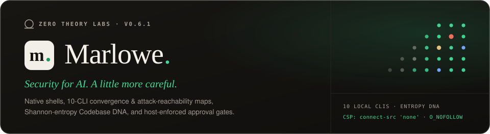
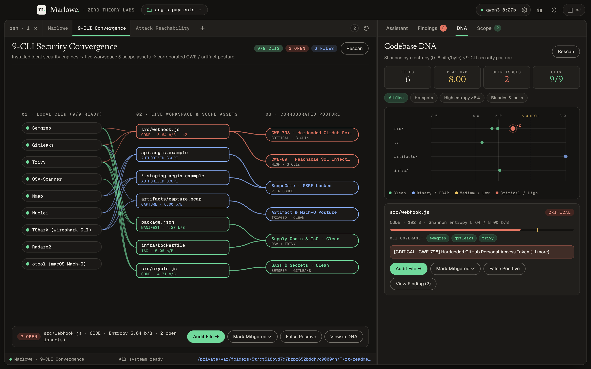
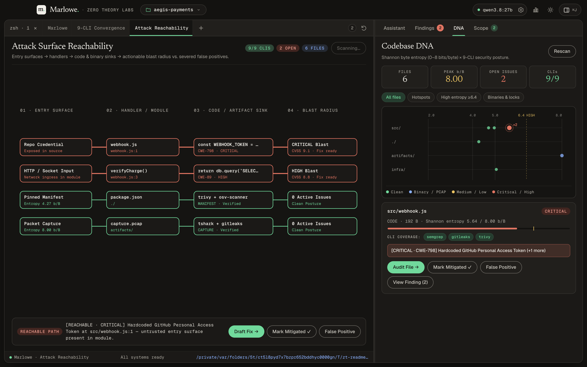
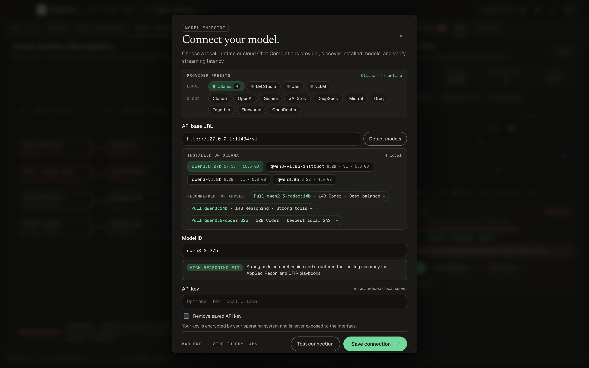
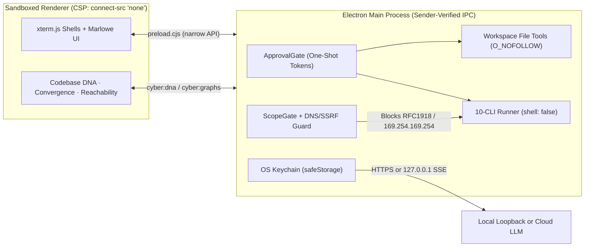

<div align="center">

<p>
  <picture>
    <source media="(prefers-color-scheme: dark)" srcset="./docs/assets/marlowe-banner-dark.svg" />
    <source media="(prefers-color-scheme: light)" srcset="./docs/assets/marlowe-banner-light.svg" />
    
  </picture>
</p>

<p>
  <a href="https://github.com/zerotheory-labs/marlowe/releases/tag/v0.6.0"></a>&nbsp;&nbsp;
  <a href="./LICENSE"></a>&nbsp;&nbsp;
  <a href="./MacOS"></a>&nbsp;&nbsp;
  <a href="./WindowsOS"></a>
</p>

<p>
  <a href="#10-cli-security-toolchain"></a>&nbsp;&nbsp;
  <a href="./SECURITY.md"></a>&nbsp;&nbsp;
  <a href="#validation--tests"></a>
</p>

<p>
  <a href="https://github.com/zerotheory-labs/marlowe-ci"><b>Marlowe CI</b></a> &nbsp;·&nbsp;
  <a href="./MacOS"><b>MacOS/</b></a> &nbsp;·&nbsp;
  <a href="./WindowsOS"><b>WindowsOS/</b></a> &nbsp;·&nbsp;
  <a href="./LinuxOS"><b>LinuxOS/</b></a> &nbsp;·&nbsp;
  <a href="#three-live-security-visualizations"><b>3 Security Maps</b></a> &nbsp;·&nbsp;
  <a href="#connect-a-model-local-air-gapped-or-cloud"><b>14 Model Providers</b></a> &nbsp;·&nbsp;
  <a href="#architecture--trust-boundaries"><b>Architecture</b></a> &nbsp;·&nbsp;
  <a href="./SECURITY.md"><b>Security Policy</b></a> &nbsp;·&nbsp;
  <a href="./LICENSE"><b>License</b></a>
</p>

</div>

---

**Marlowe.** (`v0.6.0`, by **[Zero Theory Labs](https://github.com/zerotheory-labs)**) is a source-available desktop terminal and cybersecurity workbench. It pairs real interactive shells (`node-pty` + `xterm.js`) with a taint-verifying security agent, **Codebase DNA** entropy mapping, **10-CLI Security Convergence** & **Cross-File Attack Reachability** graphs, **Shirudo Upatch** drafting + TPM 2.0 attestation verification, host-enforced **Approve once** gates, `ScopeGate` SSRF confinement, and **SARIF v2.1.0** finding ledgers.

<p align="center">
  
</p>

<table>
  <tr>
    <td width="50%">
      
      <p align="center"><sub><b>Attack Reachability</b> — Cross-file entry surfaces → handlers → sinks → blast radius</sub></p>
    </td>
    <td width="50%">
      
      <p align="center"><sub><b>Model Command Center</b> — Local Ollama/LM Studio/Jan/vLLM radar + 10 cloud presets</sub></p>
    </td>
  </tr>
</table>

> [!IMPORTANT]
> **Source-Available, Non-Commercial License:** Marlowe is licensed under the **[PolyForm Noncommercial License 1.0.0](./LICENSE)**. Personal, academic, educational, non-profit, and non-commercial security research uses are free. Commercial or workplace use requires a commercial license from **Zero Theory Labs**.

> [!TIP]
> **Using Claude Code, Cursor, Codex, or GitHub Actions?** Run **[Marlowe CI / Guard](https://github.com/zerotheory-labs/marlowe-ci)** (`v0.6.0` on GitHub, [on npm](https://www.npmjs.com/package/@zerotheory-labs/marlowe-ci)) in your repo with `npx @zerotheory-labs/marlowe-ci init --all-agents` for real-time Claude Code hooks, 13 read-only MCP tools, cross-file reachability, full 10-rule Shirudo Beefile/BPF/TPM audits (`SHIRUDO-BPF/BEE/TPM`), and SARIF PR checks:
> ```sh
> npx --yes @zerotheory-labs/marlowe-ci init --claude --mcp
> ```

---

## Operating System Folders

All platforms build from the **single shared codebase** at this repository root (`electron/` + `src/`). Download prebuilt `macOS-arm64`, `Windows-x64`, and `Linux-x64` desktop archives + `SHA256SUMS` from [GitHub Releases](https://github.com/zerotheory-labs/marlowe/releases/tag/v0.6.0), or pick your OS folder for native toolchain prerequisites, 10-CLI security installers, and desktop packaging scripts:

| OS Folder | Target Platforms | Validation Status | 1-Command Toolchain / Build |
| :--- | :--- | :--- | :--- |
| **[`MacOS/`](./MacOS)** | macOS 14+ (`arm64` & `x64`) | `VALIDATED` | `brew bundle --file=MacOS/Brewfile && ./MacOS/build-macos.sh` |
| **[`WindowsOS/`](./WindowsOS)** | Windows 11 (`x64` & `arm64`) | `EXPERIMENTAL` | `.\WindowsOS\build-windows.ps1` *(see [`WindowsOS/README.md`](./WindowsOS/README.md))* |
| **[`LinuxOS/`](./LinuxOS)** | Ubuntu / Debian / Fedora / Arch | `EXPERIMENTAL` | `./LinuxOS/build-linux.sh` *(see [`LinuxOS/README.md`](./LinuxOS/README.md))* |

---

## Quickstart

Requires **Node.js `22.12+`** and `npm` (plus C++ build tools to compile `node-pty` against Electron's ABI):

```sh
# 1. Clone the repository
git clone https://github.com/zerotheory-labs/marlowe.git
cd marlowe

# 2. (macOS optional) Install the 9 Homebrew security CLIs + Ollama (add Shirudo on Linux for 10/10)
brew bundle --file=MacOS/Brewfile

# 3. Install dependencies, build the renderer, and launch Marlowe
npm install
npm start
```

```sh
# Development build (unminified sourcemaps) or unsigned desktop bundle (release/)
npm run dev
npm run package
```

---

## Three Live Security Visualizations

| Visualization | Location | What It Computes |
| :--- | :--- | :--- |
| **Codebase DNA** | Right Drawer (`DNA`) | Plots every workspace file across **Shannon byte entropy (`0.00–8.00 bits/byte`)** × directory lanes × **10-CLI posture** (`Clean`, `Binary / PCAP`, `UPATCH`, `Medium / Low`, `Critical / High`). Remediated files turn `#3ddc97` green on **Rescan**. |
| **10-CLI Security Convergence** | Main Stage Tab | Interactive 3-column bipartite graph linking installed local security engines → live workspace & authorized scope assets → corroborated CWE / Shirudo / supply-chain posture. |
| **Attack Reachability** | Main Stage Tab | Maps untrusted entry surfaces (`HTTP`, `CLI`, `CI`, `Manifest`, `Capture`) → handler modules → code/artifact sinks → actionable blast radius (with **Draft Fix** & **Draft Shield** handoff). |

---

## Connect a Model (Local Air-Gapped or Cloud)

Press **⌘,** (`Ctrl+,` on Windows/Linux) or click the gear icon to open **Connect your model.**:

- **Local Loopback Radar (`Zero Data Egress`):** Automatically probes `127.0.0.1` for **Ollama (`:11434`)**, **LM Studio (`:1234`)**, **Jan (`:1337`)**, and **vLLM (`:8000`)**, inventories local weights, displays a **Security-Fit Advisor** (flagging small models prone to SAST false positives vs. 14B–32B+ reasoning coders), and triggers 1-click `ollama pull` in your active terminal.
- **10 Cloud Provider Presets:** Built-in endpoints, auth headers (`Bearer` & Anthropic `x-api-key`), and curated AppSec model chips for **Claude**, **OpenAI**, **Gemini**, **xAI Grok**, **DeepSeek**, **Mistral**, **Groq**, **Together**, **Fireworks**, and **OpenRouter**.
- **OS Keychain Encryption & Redirect Refusal:** Keys are encrypted via Electron `safeStorage` (macOS Keychain / Windows DPAPI / Linux Secret Service), wiped on endpoint change unless re-supplied, and never exposed to the renderer. Redirects (`3xx`) are rejected so credentials never forward across hosts.

---

## 10-CLI Security Toolchain

Marlowe ships **zero-dependency built-in Node.js analyzers** (`scan_secrets`, `audit_code_patterns`, `audit_dependencies` + CycloneDX 1.5 SBOM + OSV.dev, `inspect_http_security`, `inspect_tls`, `dns_recon`, `probe_ports`, `triage_artifact`, `extract_iocs`, `analyze_logs`, `audit_shirudo_upatch`, `verify_shirudo_attestation`) that work out of the box.

When external CLIs are installed on your verified login `PATH`, **Toolchain Doctor** unlocks `run_security_scanner` via `spawn(binary, argv, { shell: false })` behind **Approve once**:

| CLI Engine | Domain | Execution Guard | Noise & Secret Handling |
| :--- | :--- | :--- | :--- |
| **`semgrep`** | AST / Taint SAST | Workspace confined · `Approve once` | Suppresses `INFO` / low-confidence noise; rolls up duplicate rule hits |
| **`gitleaks`** | Secret Scanning | Workspace confined · `Approve once` | Masks raw tokens; skips `target/` & build artifact caches |
| **`trivy`** | IaC, Containers & Lockfiles | Workspace confined · `Approve once` | Deduplicates per-file CVE & misconfiguration findings |
| **`osv-scanner`** | Supply-Chain Advisories | Workspace confined · `Approve once` | Corroborates lockfile dependencies against live OSV advisories |
| **`nmap`** | Service & Port Discovery | `ScopeGate` + DNS-rebinding check · `Approve once` | Rejects out-of-scope, RFC1918, loopback & cloud-metadata IPs |
| **`nuclei`** | Template Verification | `ScopeGate` + DNS-rebinding check · `Approve once` | Bounded preset severity profiles |
| **`tshark`** | PCAP Packet Forensics | Workspace confined · `Approve once` | Structured protocol & conversation summary |
| **`radare2`** | Binary / ELF / PE Triage | Workspace confined · `Approve once` | Non-executing header, symbol & string inspection |
| **`otool`** | macOS Mach-O Inspection | Workspace confined · `Approve once` | Linked dylibs, load commands & hardening flags *(macOS)* |
| **`shirudo`** | eBPF Upatch & TPM 2.0 Attest | Operator-side · `.shirudo` blocked · `Approve once` on draft/run | Audits `Beefile`/`.bpf.c`; verifies TPM quotes cleanly against verified `PATH` |

---

## Architecture & Trust Boundaries



### Agent Execution & Approval Policy

| Action | Host Enforcement |
| :--- | :--- |
| List, find, search, and read workspace text files | **Automatic** — `.env*`, `.git`, SSH/cloud keys, symlinks (`O_NOFOLLOW`), hard links, and binaries are refused |
| Built-in local passive analyzers (`scan_secrets`, `audit_code_patterns`, `triage_artifact`, `analyze_logs`, `extract_iocs`) | **Automatic** within selected workspace; raw secret values are masked before reaching the model |
| Create new file / focused exact-match edit | **Automatic** unless deleting text, blanking content, replacing the whole file, or replacing >100 lines |
| Overwrite or delete an existing file | **Approve once** — inspect bounded `+N −M` line diff (or full before/after file) |
| Exact `pwd`, `ls`, `ls -l`, `ls -a`, `ls -la` | **Automatic** via fixed system binaries on macOS/Linux |
| Active TCP port probes, external CLI scanners, and shell commands (`run_command`) | **Approve once** — inspect exact command/argv, working directory, scope target, and timeout |

> [!NOTE]
> **Unsandboxed Shell Caveat:** Interactive terminal tabs and user-approved `run_command` actions execute as your OS user and **are not OS-sandboxed**. File-tool path restrictions do not confine shell commands you explicitly approve. Always review the command on the approval card before clicking **Approve once**.

<details>
<summary><b>Runtime Limits, Data Retention, Backups & Shell Integration Details</b></summary>

<br />

- **Playbook budgets:** `Engineering` runs up to `12` model rounds / `32` tool actions; `AppSec Audit`, `Authorized Recon`, and `DFIR Triage` run up to `24` rounds / `64` actions (`30 min` wall-clock cap including approval wait).
- **Clean `PATH`-only command environment:** `toolchain.cjs` extracts `PATH` once from your login shell (`zsh`/`bash`/`fish`), drops relative/missing/in-workspace paths (so agent-created files cannot shadow approved command names), and strips arbitrary environment variables and API keys.
- **Snapshots & safe Undo:** File mutations write snapshots to `agent-backups/` in `userData`. **Undo file change** restores a file only if disk contents still match the agent's output, protecting newer manual edits.
- **Terminal context consent:** Terminal buffer sharing is **off by default**. Checking **Attach terminal output** captures a one-shot snapshot (`16,000` chars max) with **Preview** and **Redact secrets** controls before sending.
- **Non-invasive `zsh` integration:** Session-only startup shims in `userData/shell/zsh/` track CWD, Git branch, and exit codes without modifying `~/.zshrc`.
- **Local storage paths:**
  - macOS: `~/Library/Application Support/Marlowe/`
  - Windows: `%APPDATA%\Marlowe\`
  - Linux: `~/.config/Marlowe/`

</details>

---

## Validation & Tests

```sh
# Run 60 Node.js unit tests (ScopeGate, SSRF guard, analyzers, Shirudo 10-rule engine, findings reconciliation, agent gates)
npm test

# Run Playwright Electron E2E desktop suites against a local deterministic SSE server
env -u ELECTRON_RUN_AS_NODE npm run test:e2e
```

Tests run offline in isolated temporary `userData` directories and never call paid external APIs. You can also run **Agent reliability → Run checks** inside the app at any time to execute production safeguard self-tests in a disposable workspace.

---

## Project Layout

```text
marlowe/
├── MacOS/                  # macOS setup guide, 9-CLI Brewfile (10th CLI: Linux Shirudo) & .app builder (Validated)
├── WindowsOS/              # Windows setup guide, winget CLI script & .exe builder (Experimental)
├── LinuxOS/                # Linux setup guide, distro CLI script & bundle builder (Experimental)
├── electron/
│   ├── main.cjs            # Window lifecycle, sender-verified IPC, PTYs, safeStorage
│   ├── preload.cjs         # Narrow context-isolated renderer bridge
│   ├── provider.cjs        # Local loopback radar + 10 cloud presets + SSE client
│   ├── agent.cjs           # Playbook loop, claim guards & bounded tool orchestration
│   ├── agent-tools.cjs     # O_NOFOLLOW workspace file tools, ApprovalGate & backups
│   ├── cyber-scope.cjs     # ScopeGate, DNS-rebinding/SSRF guard & secret redactor
│   ├── cyber-analyzers.cjs # AppSec, SBOM/OSV, TLS/HTTP/DNS, DFIR, DNA & stage graphs
│   ├── cyber-toolchain.cjs # Toolchain Doctor & shell:false wrappers for 10 CLIs
│   └── findings.cjs        # Deduplicated Findings Ledger, reconciliation & SARIF v2.1.0
├── src/                    # Sandboxed UI, Codebase DNA, Convergence & Reachability maps
└── test/                   # 60 unit tests (*.test.cjs) + 3 Electron E2E suites (*.e2e.cjs)
```

---

## Security & License

- **Vulnerability reporting & trust boundaries:** **[`SECURITY.md`](./SECURITY.md)**
- **License:** **[PolyForm Noncommercial License 1.0.0](./LICENSE)** — Copyright © Zero Theory Labs
- **Bundled fonts & open-source notices:** **[`THIRD_PARTY_NOTICES.md`](./THIRD_PARTY_NOTICES.md)**
